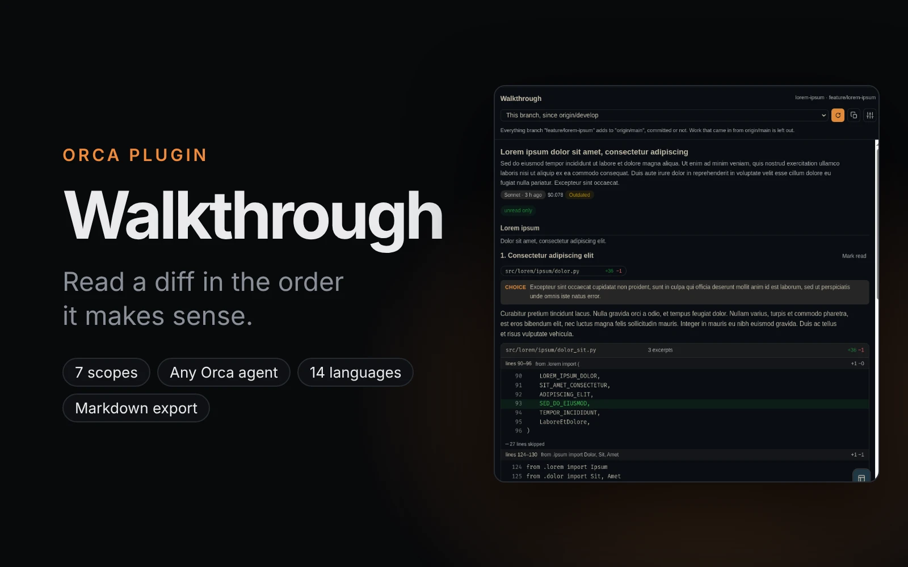
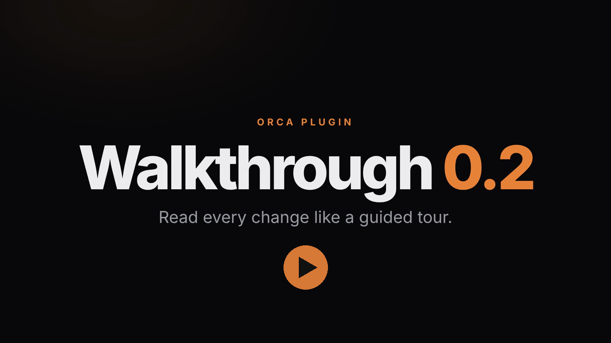
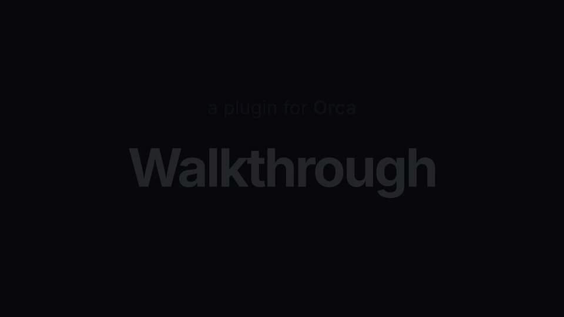

# Walkthrough for Orca



A port of [herdr-walkthrough](https://github.com/dmazlum/herdr-walkthrough) as an
[Orca](https://github.com/stablyai/orca) plugin: **read a diff in the order it makes
sense.** Instead of listing files alphabetically, an agent — Claude, Codex, OpenCode,
or whichever Orca runs — groups the diff's hunks into steps, orders them so each
builds on the last, and explains each one with its code alongside. The explanation
describes and never judges; an optional **Review** beside it scores the complexity
and names the risks, each resting on the code it points at.

**New in 0.2** — the panel becomes a reader with every step as a card, an optional
Review (complexity, areas, risks, contracts), a full-width tab, asking an agent or
starting a new session from a step, and paired Orca servers.

[](https://github.com/FelipeMayerDev/orca-walkthrough/blob/media/walkthrough-0.2.0.mp4)



## Install

```sh
orca plugin install FelipeMayerDev/orca-walkthrough
```

Orca shows the requested permissions and an approval fingerprint. Review them,
then repeat the command with `--approve <fingerprint>`. It is also listed in Orca's
**Community** plugins as **Walkthrough**
([plugin page](https://onorca.dev/plugins/felipemayerdev/orca-walkthrough)).

Requires Orca 1.4.248+, `git`, and at least one agent CLI that Orca has enabled and
that is logged in (Claude Code, Codex, OpenCode, Oh My Pi, ZCode or Hermes). Pull
requests are read with the GitHub CLI, `gh`.

**What it can see and send.** The plugin runs a trusted worker with your user
account's access and requests `workspace:read`, `agent:read`, `settings:own`, and
`agent:launch` with `terminal:send` (only used when you send a step to an agent). It
reads the repository's diff and, for task matching, Claude Code's local transcripts.
When — and only when — you press **Generate**, the diff is sent to the agent you
picked, and through it to that agent's model provider. It keeps no telemetry of its
own.

Open the **Walkthrough** panel in Orca's right sidebar, pick what to read —
uncommitted work, the staged part, the branch, one commit, a pull request, or the
last turn of an agent — and press **Generate**. The panel becomes the reader: an
overview (summary, task, review, where the lines went, every step as a card), then
one step at a time with its code and your place kept. The open icon shows the same
reader full width in an editor tab, with a rail of every step. Walk it with
`j`/`k`, mark steps read with `x`, go back to the overview with `Esc`.

## What it does

- **Readable structure** — related edits across files become one step; types and entry
  points come before the code that uses them; tests sit with the code they prove.
  Steps are grouped into parts; **Key change** flags the critical ones, **Context** the
  skimmable ones. Each step carries a chip per file it touches (`path +N −M`,
  clickable to that file's code) and every excerpt is labelled with the lines it
  covers (`lines 42–58`, the function it sits in, its own counts); the same ranges
  travel with **Copy** (`path +N −M L42–58`).
- **Notes, only where they earn their place** — a note states something the reader
  signs up for by accepting the change, and nothing more: Decisions, Upkeep,
  Limitations, Divergences, Untested aspects. Most steps have none.
- **Coverage honesty** — edits no step explains are listed under **Not covered**;
  lockfiles and generated files are listed but not analyzed.
- **Task matching** — the diff is matched against what was asked: the prompt a turn
  answered, the prompts sent to Claude Code agents while the change was made (read
  from local transcripts), a pull request's description, a commit's message, or your
  own words. Each request is marked ✓ carried out, ◐ partly, ○ not in this diff.
- **Staleness** — steps are tied to exact code; when an agent keeps editing, steps mark
  themselves **outdated**. Read marks (`x`) persist across sessions, per repository.
- **Review** (optional, on by default) — a complexity score from 1 to 10 by halves
  with its reason, the areas the change reaches, its risks (high, medium, low) and
  the contracts it changes (API, data, config, dependencies, flags). Every item
  names the hunks it rests on and is dropped when it names none; risky steps carry
  a ⚑. The overview also says which steps change tests.
- **Ask an agent about a step** — from a step in the tab, send a question or an
  instruction to an agent already running in the workspace, start a new one, or
  start a **New session**: a child worktree off the current branch (through
  `orca worktree create`) with an agent given the step, its explanation and where
  its code is.
- **Paired Orca servers** — when the workspace lives on a paired server, the panel
  forwards its requests to the plugin there (loaded for development), so git and
  the agents run where the code is.
- **Sharing** — **Copy** puts the whole walkthrough on the clipboard as Markdown,
  bounded by `<!-- walkthrough -->` comments so it can be pasted into a PR description
  and later told apart from the task.

## Scopes

Uncommitted, Staged, Unstaged, Branch (everything this branch adds to its base,
committed or not), one Commit, a Pull request (through the GitHub CLI, `gh`), or
**Last turn**: only what an agent changed while answering one prompt — not your
edits before it, not the ones after. Recent turns are listed under **Turns**, the
newest first.

## How it works

One generation is one run of an agent's CLI — **whichever agents Orca has enabled**
(the panel reads Orca's own list, and each agent's model list from Orca's catalog,
the same one its pickers are built of). The run has no tools, no MCP servers and no
session persistence — the model reads a digest of the diff (every reviewable hunk in
full, under short aliases `h1, h2, …`) and answers with a single JSON object that is
normalized against the digest: an alias that isn't there is dropped, never drawn as a
step pointing at nothing. Lockfiles and generated files are kept out of what the model
reads but never out of what you see. Task matching reads Claude Code's transcripts,
so a walkthrough made by another agent explains without matching.

- Results are cached by everything that decides them (the code, model, language,
  preferences, task, review on or off) — putting the working tree back the way it was brings the earlier
  walkthrough back free.
- A run goes on in the background even with the panel closed; the next look finds the
  answer. A watchdog stops a hung run.
- Diffs over roughly 175k tokens are refused rather than truncated, because a
  walkthrough of half a diff reads as confidently as one of the whole.
- Nothing is sent to the model until you press Generate.

Data lives under `~/.local/share/orca/walkthrough/` (entries, pointers, jobs, read
marks, turns). Opening a walkthrough in a tab writes a small
`.walkthrough/<scope>.walkthrough.json` naming it in the workspace, kept out of git
through `.git/info/exclude`.

## Turns

While the plugin is enabled, its worker listens to Orca's `agent.status.changed`:
when an agent starts answering, the working tree is snapshotted; when it stops
(whatever the outcome — a cancelled turn still changed the tree), again. The diff
of the two trees is the turn. The snapshots are written with a private index and
object directory inside the plugin's own data folder, so the repository's `.git`
is never written — not even a modification time. New files over 1 MB stay out,
like in the walkthrough itself. Twenty turns are kept per repository.

Turns are recorded only while Orca runs — the small status bar item (● turn)
marks when one is being recorded, and keeps the worker alive from Orca's boot so
no turn before the first panel open is missed. An agent already working when the
plugin loads starts a whole turn at its next prompt. What the person asked in a
turn (read from Claude Code's transcripts) becomes the walkthrough's task; for
agents without transcripts the walkthrough simply explains without matching.

## Settings

In Orca's Settings → Plugins → Walkthrough, and behind the ⚙ in the panel:

- **Agent** (panel only) — which of Orca's enabled agents reads the diff: the ones
  whose CLIs are installed (Claude, ZCode, Codex, OpenCode, Oh My Pi, Hermes…),
  each with its own model list — Orca's catalog, the account's default first.
- **Model** — Claude's default when no agent is chosen: Haiku (fast and cheap),
  Sonnet or Opus.
- **Language** — the language the walkthrough is written in (prose only; code
  identifiers stay as they are).
- **Review** — add the review (complexity, areas, risks, contracts) to every
  walkthrough. Off, the walkthrough only orders and explains, asked for exactly as
  before.
- **Preferences** — your own wishes for every walkthrough, added to every prompt.

## Development

```sh
npm install
npm run types       # writes .orca/types (Orca plugin typings)
npm run typecheck
npm test            # orca plugin test .
orca plugin dev watch .
```

`orca` is `orca-ide` on Linux. `dev watch` loads the folder into Orca as a development
plugin and reloads on save; the first load needs an access approval it prints.

## License

MIT, like the original herdr-walkthrough by dmazlum.
